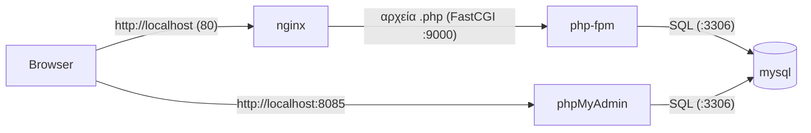
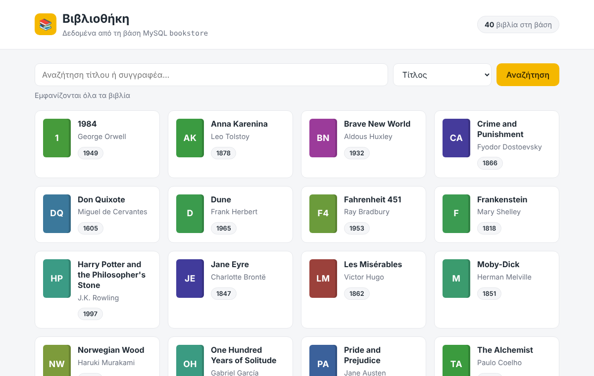
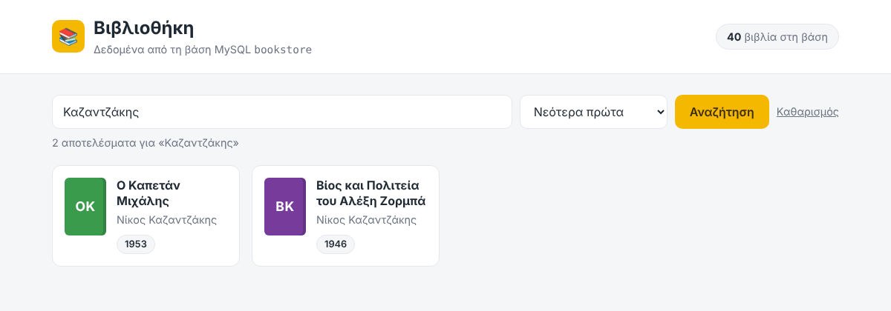
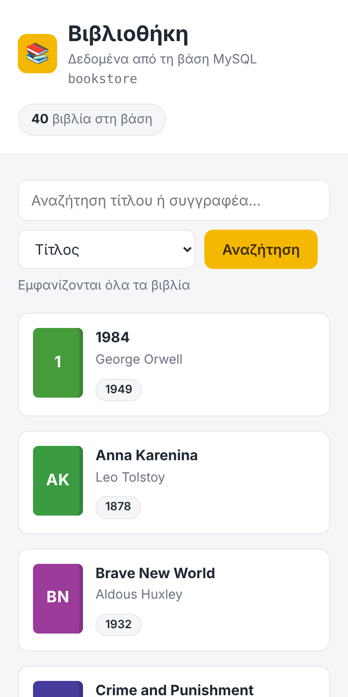

# WebServer-Dockers-ECE

Εργαστηριακό περιβάλλον για το μάθημα **Δικτυακός Προγραμματισμός** (ενότητα Docker).
Με μία εντολή στήνεται ένας πλήρης web server με **Nginx**, **PHP-FPM**, **MySQL** και **phpMyAdmin**, ο καθένας στο δικό του container.

> Χρειάζεστε μόνο **Docker Desktop**. Δεν εγκαθιστάτε PHP, MySQL ή web server στον υπολογιστή σας.

---

## Περιεχόμενα

- [Αρχιτεκτονική](#αρχιτεκτονική)
- [Προαπαιτούμενα](#προαπαιτούμενα)
- [Γρήγορη εκκίνηση](#γρήγορη-εκκίνηση)
- [Έλεγχος λειτουργίας](#έλεγχος-λειτουργίας)
- [Εργασία: η βάση bookstore](#εργασία-η-βάση-bookstore)
- [Πώς συνδέεται η PHP με τη βάση](#πώς-συνδέεται-η-php-με-τη-βάση)
- [Δομή του project](#δομή-του-project)
- [Χρήσιμες εντολές](#χρήσιμες-εντολές)
- [Συχνά προβλήματα](#συχνά-προβλήματα)

---

## Αρχιτεκτονική



| Service      | Image            | Ρόλος                                  | Πρόσβαση από τον υπολογιστή |
|--------------|------------------|----------------------------------------|-----------------------------|
| `nginx`      | `nginx:1.30`     | Web server, σερβίρει τις σελίδες       | http://localhost            |
| `php`        | `php:8.4-fpm`    | Εκτελεί τον κώδικα PHP                 | μόνο εσωτερικά (θύρα 9000)  |
| `mysql`      | `mysql:8.4` (LTS)| Βάση δεδομένων                         | `localhost:3306`            |
| `phpmyadmin` | `phpmyadmin:5.2` | Διαχείριση της βάσης από τον browser   | http://localhost:8085       |

Τα containers βρίσκονται στο ίδιο δίκτυο Docker και βλέπουν το ένα το άλλο **με το όνομα του service**. Γι' αυτό στον κώδικα PHP ο host της βάσης είναι `mysql` και όχι `localhost`.

---

## Προαπαιτούμενα

1. **Windows 10/11 με WSL 2.** Σε PowerShell ως διαχειριστής:
   ```powershell
   wsl --install
   ```
   Κάντε επανεκκίνηση όταν ζητηθεί. Έλεγχος με `wsl -l -v` (η στήλη VERSION πρέπει να δείχνει `2`).
2. **[Docker Desktop](https://www.docker.com/products/docker-desktop/)**, με:
   - *Settings → General → Use the WSL 2 based engine* ενεργοποιημένο
   - *Settings → Resources → WSL integration* ενεργοποιημένο για τη διανομή Ubuntu
   ([οδηγίες](https://docs.docker.com/desktop/features/wsl/))
3. *(Προαιρετικά)* **VS Code** με την επέκταση **WSL**.

> Το Docker Compose περιλαμβάνεται στο Docker Desktop. Η εντολή είναι `docker compose` (με κενό, χωρίς παύλα).

---

## Γρήγορη εκκίνηση

Από το τερματικό του WSL (Ubuntu):

```bash
git clone https://github.com/chitiris/WebServer-Dockers-ECE.git
cd WebServer-Dockers-ECE/webserver
docker compose up -d --build
```

Την πρώτη φορά θα κατέβουν τα images, οπότε χρειάζεται λίγος χρόνος. Το `-d` (detached) αφήνει τα containers να τρέχουν στο background.

> **Προσοχή:** στο Linux τα ονόματα φακέλων διακρίνουν κεφαλαία/πεζά (`WebServer-Dockers-ECE` ≠ `WebServer-dockers-ECE`).

---

## Έλεγχος λειτουργίας

| Διεύθυνση                       | Τι πρέπει να δείτε                                  |
|---------------------------------|-----------------------------------------------------|
| http://localhost                | Τη σελίδα `phpinfo()` με τις πληροφορίες της PHP     |
| http://localhost/mysql.php      | `Connected successfully`                            |
| http://localhost:8085           | Τη σελίδα login του phpMyAdmin                       |

Στοιχεία σύνδεσης phpMyAdmin: **Username:** `root` · **Password:** `123456`

---

## Εργασία: η βάση bookstore

1. Ανοίξτε το phpMyAdmin (http://localhost:8085) και συνδεθείτε.
2. **Import → Choose file →** `webserver/bookstore.sql` **→ Import**.
   Δημιουργείται η βάση `bookstore` με τον πίνακα `books` (40 βιβλία, ελληνικά και ξένα).
3. Ανοίξτε το **http://localhost/library.php**.

Η σελίδα εμφανίζει τα βιβλία σε κάρτες, με **αναζήτηση** σε τίτλο ή συγγραφέα και **ταξινόμηση** (τίτλος, συγγραφέας, έτος). Αν δεν έχει γίνει ακόμα το import, εμφανίζει μήνυμα με οδηγίες αντί για σφάλμα.



Αναζήτηση με ελληνικούς χαρακτήρες και ταξινόμηση «Νεότερα πρώτα»:



<details>
<summary>Εμφάνιση σε κινητό</summary>
<p align="center">
  
</p>
</details>

---

## Πώς συνδέεται η PHP με τη βάση

Στα αρχεία `src/library.php` και `src/mysql.php` κάθε σημείο όπου η σελίδα «μιλάει» με τη βάση έχει σχόλιο **`[ΒΑΣΗ Χ]`**. Αναζητήστε τη λέξη `ΒΑΣΗ` στον editor για να τα δείτε με τη σειρά:

| Βήμα       | Τι γίνεται                                                     |
|------------|----------------------------------------------------------------|
| `[ΒΑΣΗ 1]` | Στοιχεία σύνδεσης: host `mysql`, χρήστης, κωδικός, βάση       |
| `[ΒΑΣΗ 2]` | Άνοιγμα σύνδεσης (`new mysqli(...)`)                           |
| `[ΒΑΣΗ 3]` | Κωδικοποίηση `utf8mb4`, για σωστά ελληνικά                    |
| `[ΒΑΣΗ 4]` | Απλό ερώτημα SQL (`SELECT COUNT(*)`)                           |
| `[ΒΑΣΗ 5]` | Prepared statement με `?` και `bind_param` (κατά SQL injection)|
| `[ΒΑΣΗ 6]` | Ανάκτηση των γραμμών σε πίνακα PHP (`fetch_all`)               |
| `[ΒΑΣΗ 7]` | Κλείσιμο της σύνδεσης                                          |
| `[ΒΑΣΗ 8]` | Χειρισμός σφαλμάτων (`try / catch`)                            |
| `[ΒΑΣΗ 9]` | Εμφάνιση των δεδομένων μέσα στο HTML                           |

Τα στοιχεία σύνδεσης της MySQL ορίζονται στο `env/mysql.env`:

```ini
MYSQL_ROOT_PASSWORD=123456
MYSQL_DATABASE=DockerDB
MYSQL_USER=duser
MYSQL_PASSWORD=123456
```

---

## Δομή του project

```
webserver/
├── docker-compose.yml        # ορισμός των 4 services
├── bookstore.sql             # βάση για την εργασία (import από phpMyAdmin)
├── docker/
│   ├── nginx/
│   │   ├── Dockerfile        # image του nginx + ρυθμίσεις
│   │   └── default.conf      # προώθηση των .php στο php-fpm
│   └── php/
│       └── Dockerfile        # PHP 8.4 + επεκτάσεις mysqli, pdo_mysql
├── env/
│   └── mysql.env             # κωδικοί της MySQL
├── src/                      # οι σελίδες του site (→ /var/www/html)
│   ├── index.php             # phpinfo()
│   ├── mysql.php             # έλεγχος σύνδεσης (PDO)
│   └── library.php           # λίστα βιβλίων (mysqli)
├── logs/nginx/               # access.log, error.log
└── database/mysql/           # δεδομένα MySQL (δημιουργείται αυτόματα)
```

Οι φάκελοι `src/`, `logs/nginx/` και `database/mysql/` συνδέονται με τα containers μέσω **volumes**. Κάθε αλλαγή σε αρχείο του `src/` φαίνεται αμέσως στον browser, χωρίς rebuild.

---

## Χρήσιμες εντολές

```bash
docker compose up -d --build   # δημιουργία images και εκκίνηση στο background
docker compose ps              # κατάσταση των containers
docker compose logs -f php     # logs ενός service (Ctrl+C για έξοδο)
docker compose exec mysql mysql -uroot -p123456   # κονσόλα MySQL
docker compose stop            # σταμάτημα (τα containers διατηρούνται)
docker compose down            # σταμάτημα και διαγραφή containers/δικτύου
```

---

## Συχνά προβλήματα

**`port is already allocated` (80, 3306 ή 8085)**
Τρέχει ήδη κάποια άλλη εφαρμογή στη θύρα, π.χ. XAMPP, τοπική MySQL/MariaDB ή IIS. Σταματήστε την (Task Manager → Services) ή αλλάξτε τη θύρα **αριστερά** στο `ports:` του `docker-compose.yml`, π.χ. `"3307:3306"`.

**`docker: command not found` μέσα στο WSL**
Ενεργοποιήστε το *Settings → Resources → WSL integration* στο Docker Desktop και ανοίξτε ξανά το τερματικό.

**Η library.php λέει ότι δεν βρέθηκε η βάση**
Δεν έχει γίνει ακόμα import το `bookstore.sql`. Δείτε την ενότητα [Εργασία](#εργασία-η-βάση-bookstore).

**Η MySQL δεν ξεκινά μετά από αναβάθμιση από παλιότερη έκδοση του repo**
Τα παλιά δεδομένα (MySQL 8.0) δεν είναι συμβατά. Σβήστε τον φάκελο `webserver/database/` και τρέξτε ξανά `docker compose up -d`.

---

> ⚠️ Οι κωδικοί σε αυτό το repository είναι **μόνο για εκπαιδευτική χρήση**. Μην χρησιμοποιείτε αυτή τη ρύθμιση σε server παραγωγής.
